# Proposta 0001 – Despacho geoespacial (H3), tempo real (modelo RAMEN) e precificação no Atlas

- **Estado:** aprovada e implementada (ver o que ficou por fazer na secção 13)
- **Data:** 2026-11-01
- **Serviços abrangidos:** Táxi, Reboque, Manutenção e Mudanças
- **Mercado:** Angola primeiro, depois outros países africanos
- **Requisitos:** RF09, RF10, RF11, RF12, RF13, RF14, RF16, RF17, RF23
- **ADRs afetados:** 0008, 0009, 0010, 0011, 0012 (ver [secção 12](#12-impacto-nos-adrs))

---

## 1. Resumo

O Atlas continua a ser um **monólito modular** (ADR 0001) e passa a ter três
peças com responsabilidades separadas:

| Peça | Pergunta a que responde | Inspiração |
|---|---|---|
| **Localização** | Quem está perto ou cobre este ponto? | H3 |
| **Despacho** | A quem oferecer, por que ordem e por quanto tempo? | Políticas por serviço |
| **Entrega** | A mensagem chegou mesmo ao telemóvel? | RAMEN |

As decisões principais são:

1. **H3 é o índice, não a fonte de verdade.** Encontra candidatos depressa. A
   distância exata e os polígonos oficiais continuam em Go e no PostGIS.
2. **Os quatro serviços não usam o mesmo despacho.** Táxi e Reboque procuram
   quem está online perto do pedido. Manutenção e Mudanças procuram quem cobre
   aquela zona, mesmo com a app fechada.
3. **As diferenças entre serviços são dados, não `switch` no código**, como o
   ADR 0008 já exige. Cada categoria tem uma política configurável.
4. **Cada utilizador tem uma mailbox durável.** O envio em direto e o replay
   usam o mesmo caminho de leitura, por isso uma reconexão não é um caso
   especial.
5. **O servidor sabe se a oferta chegou.** A app confirma a entrega e, sem
   confirmação em poucos segundos, o Atlas tenta outro canal ou outro prestador.
6. **O Atlas não depende de boa rede nem de boas moradas.** O pedido assenta num
   pin no mapa e num ponto de referência, com payloads pequenos e reenvio seguro.
7. **Mantém-se SSE, sem gRPC por agora.** A [secção 14](#14-gatilhos-de-evolução)
   define as métricas que justificariam rever esta decisão.
8. **No Táxi, o preço é fixo e conhecido antes de confirmar.** Comissão baixa e
   transparente, sem negociação nem preço dinâmico algorítmico no arranque (ver
   [secção 16](#16-precificação)).

---

## 2. Princípios para o contexto africano

| Realidade | Consequência no desenho |
|---|---|
| Rede instável, com muita utilização em 3G e cobertura 4G desigual | Eventos pequenos, reconexão com replay, reenvio idempotente |
| Dados móveis têm custo para o utilizador | Cadência de GPS e heartbeat ajustada pelo servidor |
| Moradas informais e geocodificação incerta | Pin no mapa e ponto de referência em texto; a geocodificação só ajuda |
| Telemóveis modestos, por vezes com relógio errado | Prazos enviados como segundos restantes; SDK de mapas só carregado quando necessário |
| Poucos prestadores de certos serviços fora dos grandes centros | Raios maiores, oferta simultânea e operador como último recurso |
| App do prestador nem sempre aberta | SSE com recurso a FCM e SMS |
| Vários países | Zona, moeda, fuso e fornecedor de SMS passam a ser configuração |

Os valores numéricos desta proposta (raios, prazos, cadências) são **pontos de
partida a calibrar** com dados reais, exceto quando indicado como testado.

---

## 3. Visão geral

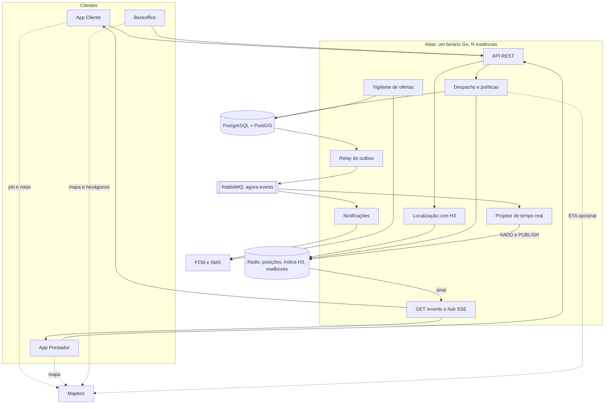

### Dois caminhos de dados, de propósito

| Caminho | Dados | Percurso | Porquê |
|---|---|---|---|
| **Duradouro** | Pedidos, ofertas, mudanças de estado | Transação + outbox → RabbitMQ → projetor → mailbox | Não se pode perder (ADR 0004) |
| **Efémero** | Posição GPS, presença | REST → Redis → Pub/Sub | Volume alto; só a última posição interessa |

As posições **nunca passam pelo outbox nem pelo RabbitMQ**. Uma posição perdida
é substituída segundos depois, mas uma oferta perdida não.

### Organização no monólito

| Pacote proposto | Responsabilidade |
|---|---|
| `infra/geo/h3index` | Único pacote que importa a biblioteca H3 |
| `infra/geo/mapbox` | Adaptador do Mapbox atrás de uma interface |
| `infra/repository` | `IProviderLocator` em Redis (interface prevista no ADR 0010, ainda por criar) |
| `usecases/dispatch` | Políticas, candidatos, ofertas e vigilante |
| `usecases/realtime` | Projetor: decide quem recebe cada evento e com que classe |
| `infra/sse` | Hub e stream HTTP, sem conhecer o domínio |

---

## 4. Política de cada serviço

Esta tabela é o centro da proposta. Torna-se a tabela `dispatch_policies`,
editável no backoffice e opcionalmente específica por zona.

| Parâmetro | Táxi | Reboque | Manutenção | Mudanças |
|---|---|---|---|---|
| **Quando** | Imediato | Imediato | Imediato ou agendado | Normalmente agendado |
| **Quem é candidato** | Online perto | Online perto | Cobre a zona | Cobre a zona |
| **Índice H3** | Vivo, res 7 | Vivo, res 5 | Cobertura, res 6 | Cobertura, res 6 |
| **Raios por tentativa** | 3 → 5 → 10 km | 10 → 30 → 80 km | Raio declarado (30 km por omissão) | Raio declarado (50 km por omissão) |
| **Modo de oferta** | Um de cada vez | 3 em simultâneo | 5 em simultâneo | Até 10, com orçamento |
| **Validade da oferta** | 20 s | 45 s | 10 min | 2 h |
| **Tempo máximo de procura** | 3 min | 10 min | 2 h | 24 h |
| **Canais da oferta** | SSE → FCM | SSE → FCM → SMS | FCM + SMS + SSE | FCM + SMS + SSE |
| **Ordenação** | Distância e tempo sem serviço | Distância | Distância à base | Distância; o cliente escolhe |
| **Destino** | Sim | Sim | Não | Sim |
| **Tracking ao cliente** | A caminho e em viagem | A caminho e em viagem | Só a caminho | A caminho e em viagem |
| **Sem prestador** | Sugerir nova tentativa | Alertar operador | Fila do operador | Alargar prazo ou fila do operador |

Porque diferem:

- **Táxi:** há muitos prestadores e o cliente espera a olhar para o ecrã. Ofertas
  em simultâneo fariam vários motoristas competir e perder tempo por cada viagem.
- **Reboque:** há poucos prestadores e o cliente pode estar parado na estrada com
  pouco sinal. Velocidade e alcance pesam mais que a equidade.
- **Manutenção:** o técnico trabalha a partir de uma base e pode estar noutro
  serviço. Não precisa de estar online no momento, por isso o prazo é longo.
- **Mudanças:** é um trabalho planeado e o preço depende dos bens. O cliente
  compara orçamentos em vez de aceitar o primeiro.

> **Em aberto:** o orçamento em Mudanças depende do modelo tarifário por decidir
> no ADR 0008. Sem orçamento, Mudanças pode começar como Manutenção: o primeiro a
> aceitar fica com o pedido.

---

## 5. Localização com H3

### 5.1 Onde cada ferramenta entra

| Necessidade | Ferramenta |
|---|---|
| Candidatos online perto de um ponto | H3 + Redis |
| Prestadores que cobrem um ponto | H3 + PostgreSQL |
| Distância exata entre candidatos | Haversine em Go |
| Zonas oficiais, moradas e pontos de pedidos | PostGIS |
| Oferta e procura por zona | Agregação por célula H3 |
| Tempo por estrada | Mapbox |

### 5.2 Resoluções

Uma aresta média global esconde bastante variação. Medimos células reais em 17
cidades africanas, incluindo Luanda, Huambo, Saurimo, Kinshasa, Lagos, Abidjan,
Nairobi, Maputo e Cairo:

| Res | Uso no Atlas | Aresta global média | Aresta mínima medida | Aresta máxima medida |
|---|---|---|---|---|
| 5 | Índice vivo de longo alcance (Reboque) | 9,85 km | 7,32 km | 10,76 km |
| 6 | Cobertura de prestadores e zonas de operação | 3,72 km | 2,90 km | 4,06 km |
| 7 | Índice vivo urbano (Táxi) | 1,41 km | 1,05 km | 1,54 km |
| 8 | Análise, mapa de calor e aprendizagem de ETA | 0,53 km | 0,41 km | 0,58 km |

### 5.3 Do raio ao número de anéis (`k`)

```
k = ceil(raio / (1,5 × aresta_mínima)) + 1
células = 3k² + 3k + 1
```

| Serviço | Res | Raio | `k` | Células | Maior `k` observado |
|---|---|---|---|---|---|
| Táxi | 7 | 3 km | 3 | 37 | 3 |
| Táxi | 7 | 5 km | 5 | 91 | 4 |
| Táxi | 7 | 10 km | 8 | 217 | 7 |
| Reboque | 5 | 10 km | 2 | 19 | 2 |
| Reboque | 5 | 30 km | 4 | 61 | 3 |
| Reboque | 5 | 80 km | 9 | 271 | 8 |

**Validação:** para cada cidade, testámos 60 origens e direções de 3 em 3 graus.
A fórmula final cobriu todos os casos da tabela. As duas tentativas anteriores
**falharam**: a primeira usava `√3 × aresta` e a aresta média, e a segunda
subestimou a variação do tamanho das células, falhando em Abidjan. Este teste deve
entrar no CI, porque um `k` pequeno esconde prestadores sem dar erro.

Razão para não usar res 8 no índice vivo: o raio de 10 km exigiria `k = 18`, ou
seja, mais de 1000 células por pesquisa.

### 5.4 Índice vivo (Táxi e Reboque)

Substitui o `GEOADD` por categoria do ADR 0010:

```
live:pos:{provider_id}                 HASH   lat, lng, heading, accuracy, ts, status, categorias
                                              EXPIRE conforme a cadência
live:idx:{categoria}:r{res}:{célula}   SET    provider_id
```

**Escrita, em cada posição recebida:**

1. Rejeitar pontos com má precisão ou saltos impossíveis.
2. Calcular as células.
3. Atualizar sempre `live:pos`.
4. Só **se a célula mudou**, tirar o prestador do `SET` antigo e pô-lo no novo.

A maior parte das posições não muda de célula, por isso não toca no índice. Com
`GEOADD`, um prestador em várias categorias reescreveria um índice por categoria
a cada ponto.

**Leitura, numa pesquisa:**

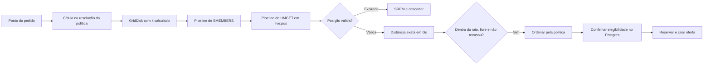

Pontos importantes:

- **Sem fuga de prestadores mortos:** um `SET` não expira membro a membro, mas o
  `HASH` expira. O prestador sem posição válida é limpo na leitura seguinte.
- **A célula é só um pré-filtro.** O `k` tem margem e cada candidato passa pela
  distância exata.
- **Resultado parcial tolerável:** a pesquisa é por rondas. Se um candidato faltar
  numa ronda, pode aparecer na seguinte.

### 5.5 Índice de cobertura (Manutenção e Mudanças)

O prestador indica uma base e um raio de serviço. Ao guardar, o Atlas calcula o
conjunto de células uma vez:

```sql
CREATE TABLE provider_coverage (
    category_id UUID   NOT NULL REFERENCES service_categories (id),
    h3_r6       BIGINT NOT NULL,
    provider_id UUID   NOT NULL,
    PRIMARY KEY (category_id, h3_r6, provider_id)
);
CREATE INDEX provider_coverage_provider_idx ON provider_coverage (provider_id);
```

Encontrar candidatos é uma única consulta pela célula do pedido, seguida do filtro
de distância à base. Um raio de 30 km em Luanda ocupa cerca de 73 linhas por
categoria em res 6, contra cerca de 512 em res 7.

Os índices H3 cabem em `BIGINT` positivo (verificado), por isso **não é preciso
instalar nenhuma extensão H3 no Postgres**.

### 5.6 Zonas e países

`service_zones` guarda o polígono oficial em PostGIS. Cada zona é convertida em
células res 6 e mantida em memória, o que permite resolver a zona de um ponto sem
consultar o PostGIS a cada pedido:

```
ponto → célula res 6 → zona em cache → política, moeda, fuso, fornecedor de SMS
                  └─ sem resultado, ou célula de fronteira → ST_Covers no PostGIS
```

### 5.7 Privacidade e análise

- O cliente vê prestadores perto **como agregados por célula**, sem identidade nem
  posição exata, e só acima de um número mínimo por célula.
- A posição exata só é partilhada entre as partes de um pedido aceite.
- O backoffice mostra oferta e procura em hexágonos res 8 sobre o Mapbox.

> **Preço dinâmico:** é possível sobre estas células, mas fica fora do arranque.
> Até lá, as células só recolhem dados (ver [secção 16.3](#163-proposta-para-o-táxi)).

### 5.8 Obstáculo de build: H3 e cgo

Este é o único ponto que muda a pipeline, e foi verificado:

- O Atlas compila sempre com `CGO_ENABLED=0` e usa uma imagem `distroless/static`.
- O `uber/h3-go` v4.5.0 **não compila sem cgo** (`build constraints exclude all Go files`).
- O CD publica `linux/amd64` e `linux/arm64` por compilação cruzada.

| Opção | Resultado | Avaliação |
|---|---|---|
| **A. `uber/h3-go` com cgo estático** | Num binário de teste em amd64 produziu um executável estático; `LatLngToCell` ≈ 350 ns e `GridDisk(k=7)` ≈ 5 µs | **Recomendada**; falta provar no Atlas e em arm64 |
| B. `akhenakh/goh3`, em Go puro | Declara-se experimental e a API Go não expõe `GridDisk` | Rejeitada |
| C. Extensão H3 no Postgres | Não testada; cada posição iria à base de dados | Rejeitada |

**Alterações da opção A:**

- `CGO_ENABLED=1` e ligação estática no `Dockerfile`, no `Dockerfile.dev`, no
  `Makefile` e no CI.
- Compilador cruzado `aarch64` na imagem de build, ou retirar arm64 se não houver
  servidores nessa arquitetura.
- Só `infra/geo/h3index` importa a biblioteca, o que permite trocá-la se surgir
  uma alternativa madura em Go puro.

---

## 6. Entrega ao estilo RAMEN

### 6.1 Do RAMEN para o Atlas

| RAMEN | Atlas |
|---|---|
| Fireball decide quando enviar | Projetor de tempo real, a partir de eventos de domínio |
| API Gateway monta o conteúdo | Projetor, com dados dos usecases |
| Streamgate entrega | Hub SSE |
| Prioridade, TTL e deduplicação | Metadados em cada mensagem |
| Sequência e replay | IDs do Redis Stream e `Last-Event-ID` |
| Ack por mensagem | Ack só em ofertas |
| Helix, ZooKeeper, Cassandra | **Não necessários:** Redis e Pub/Sub |

### 6.2 Classes de mensagem

| Classe | Exemplos | Mailbox | Ack | Recurso a outro canal |
|---|---|---|---|---|
| **Crítica** | Oferta, oferta cancelada | Sim | Sim | FCM, SMS |
| **Estado** | Aceite, a caminho, iniciado, concluído | Sim | Não | FCM em segundo plano (ADR 0012) |
| **Efémera** | Posição, ETA, nº de prestadores perto | Não, só a última | Não | Nenhum |
| **Controlo** | Cadência, `resync`, renovar token | Não | Não | Nenhum |

Formato do evento SSE. Deve manter-se abaixo de 2 KB; o detalhe vem por REST:

```text
id: 1762000000000-0
event: request.offer
data: {"event_id":"...","class":"critical","offer_id":"...","request_id":"...",
       "request_version":3,"category":"taxi","expires_in_s":18,
       "pickup":{"lat":-8.84,"lng":13.23,"reference":"Junto à farmácia"},"distance_m":850}
```

- `request_version` vem do bloqueio otimista do ADR 0009. A app ignora eventos com
  versão inferior à que já conhece, porque retries podem trocar a ordem.
- `event_id` deduplica entradas repetidas e a mesma oferta recebida por SSE e FCM.
- `expires_in_s` é relativo, para não depender do relógio do telemóvel.

### 6.3 O sinal e a mailbox

O ADR 0011 prevê enviar o evento às instâncias e gravá-lo só quando é enviado, o
que levanta dois problemas: quem está desligado não fica com o evento gravado, e o
hub descarta eventos quando um subscritor está lento. **Proposta: gravar sempre
primeiro; o hub só recebe um sinal e lê a mailbox.**

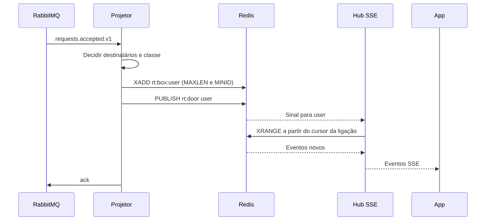

O que isto resolve:

- **Utilizador desligado:** o evento fica na mailbox à espera dele.
- **Replay e direto usam o mesmo código:** a ligação só tem um cursor; ao ligar,
  começa em `Last-Event-ID`.
- **Subscritor lento:** o sinal pode ser agrupado sem perder nada, porque os dados
  estão na mailbox.
- **Reinício de instância:** o projetor é uma fila quorum durável, sem perdas.
- **Uma ou várias instâncias:** o código é igual.

Mudança necessária em `infra/sse/hub.go`:

```go
// O canal transporta apenas um sinal; os dados vêm da mailbox.
ch := make(chan struct{}, 1)

func (h *Hub) Signal(userID string) {
    h.mu.RLock()
    defer h.mu.RUnlock()
    for ch := range h.subscribers[userID] {
        select {
        case ch <- struct{}{}:
        default: // Já há um sinal pendente, que lerá também este evento.
        }
    }
}
```

**Salvaguarda contra sinais perdidos:** o Pub/Sub não garante entrega. Por isso,
cada ligação também verifica a mailbox periodicamente (cerca de 30 s).

**Reutilização:** o projetor usa o `Consumer` existente, com retry, DLQ e
deduplicação. Falta-lhe apenas a idempotência por destinatário, para um retry
parcial não duplicar entradas.

**Atenção ao retry de 10 s:** `RABBITMQ_RETRY_DELAY=10s` consome metade de uma
oferta de táxi de 20 s. O projetor deve descartar ofertas já expiradas, e o
vigilante da [secção 6.5](#65-ack-e-recurso-a-outros-canais) trata a falha sem
esperar pelo retry.

### 6.4 Ligação, replay e heartbeat

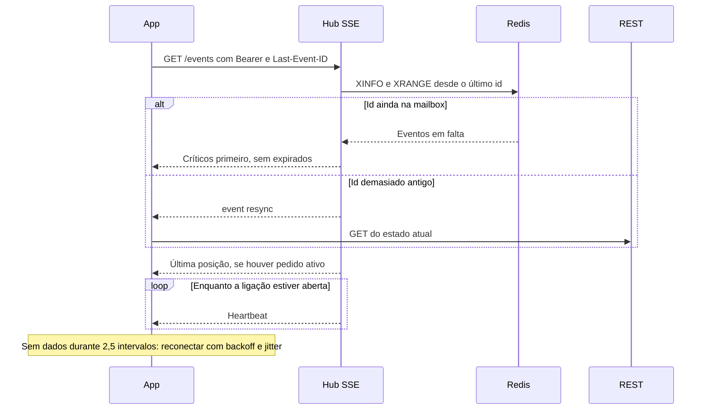

| Situação | Heartbeat | App considera morta após | Motivo |
|---|---|---|---|
| Cliente sem pedido ativo | Sem SSE | Não se aplica | Poupa bateria e dados |
| Cliente com pedido ativo | 15 s | 38 s | Atualizações importantes, sem urgência extrema |
| Prestador online, sem serviço | 15 s | 38 s | Equilíbrio com bateria |
| Prestador com serviço ativo | 15 s | 38 s | O tracking já mantém o tráfego |

Limites: tem de ficar abaixo dos cerca de 100 s da Cloudflare (ADR 0011). Os
valores vão por mensagem de controlo, o que permite afinar por rede sem nova
versão da app.

**O heartbeat não protege as ofertas.** Mesmo com intervalo curto, a deteção pela
app demoraria dezenas de segundos. Quem protege a oferta é o ack.

**Reconexão em massa:** num monólito, cada deploy derruba todas as ligações. São
obrigatórios backoff com jitter nas apps e fecho gradual no servidor, com uma
mensagem de controlo a pedir reconexão distribuída no tempo.

### 6.5 Ack e recurso a outros canais

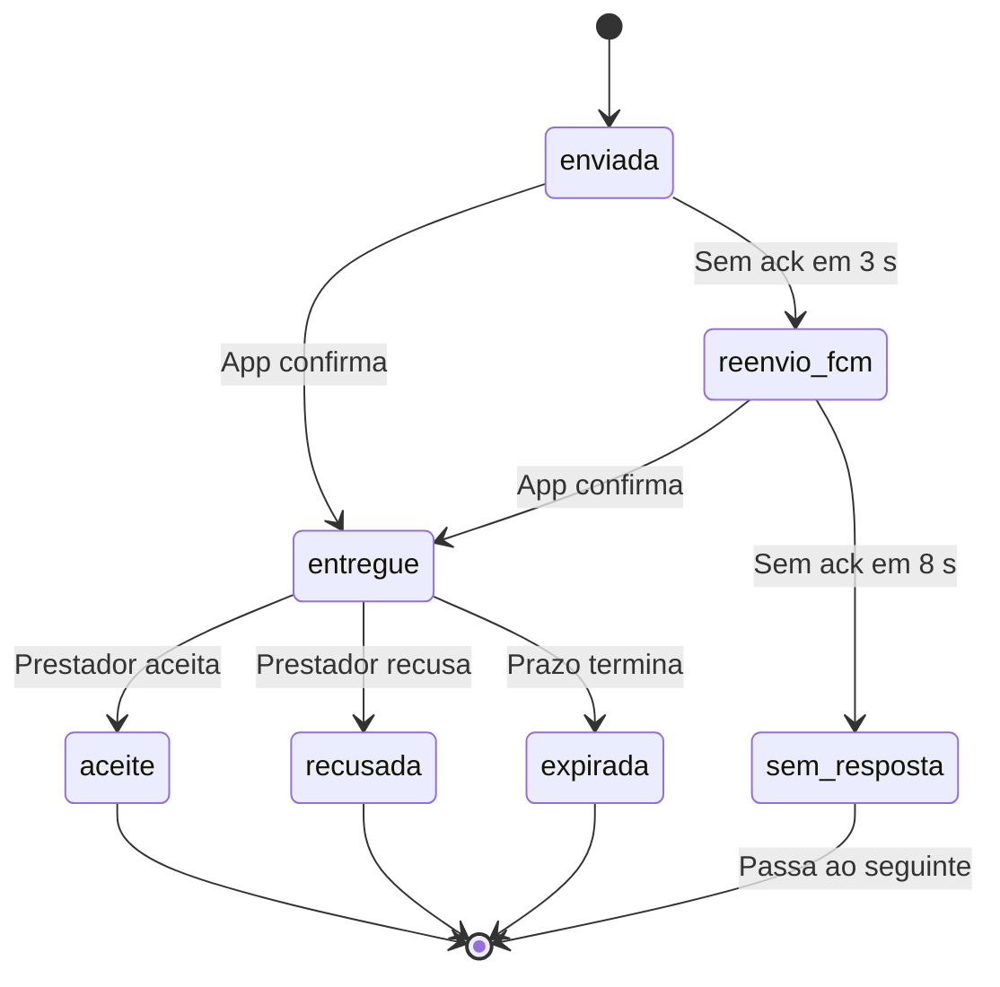

- A app confirma com `POST /v1/offers/{id}/delivered`, indicando o canal.
- O **vigilante** corre no binário com `FOR UPDATE SKIP LOCKED` sobre
  `next_action_at`, como o ADR 0009 já prevê para timeouts.
- Os tempos de 3 e 8 s são os de Táxi. As outras categorias têm tempos próprios.
- Só ofertas têm ack. Assim evitamos o custo de bytes que a Uber quis eliminar,
  ao mesmo tempo que resolvemos o problema de negócio que levou a Uber a sair do SSE.
- O tempo entre oferta e ack dá também uma medida de RTT por prestador e por rede.

---

## 7. Fluxos completos

### 7.1 Base comum

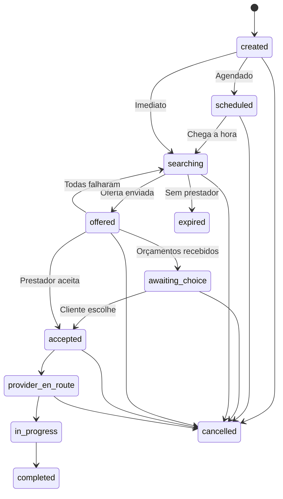

Os estados `scheduled` e `awaiting_choice` são novos em relação ao ADR 0009.

Regras comuns a todos os pedidos:

1. O pedido inclui pin, ponto de referência opcional e `Idempotency-Key`, para a
   app poder repetir o envio em redes instáveis sem criar pedidos duplicados.
2. O ponto define a zona e a política. Fora de uma zona ativa, a resposta explica
   que o serviço ainda não está disponível ali.
3. O pedido e o evento gravam-se na mesma transação (ADR 0004).
4. A aceitação usa o bloqueio otimista. Quem perde a corrida recebe `409`.

### 7.2 Táxi

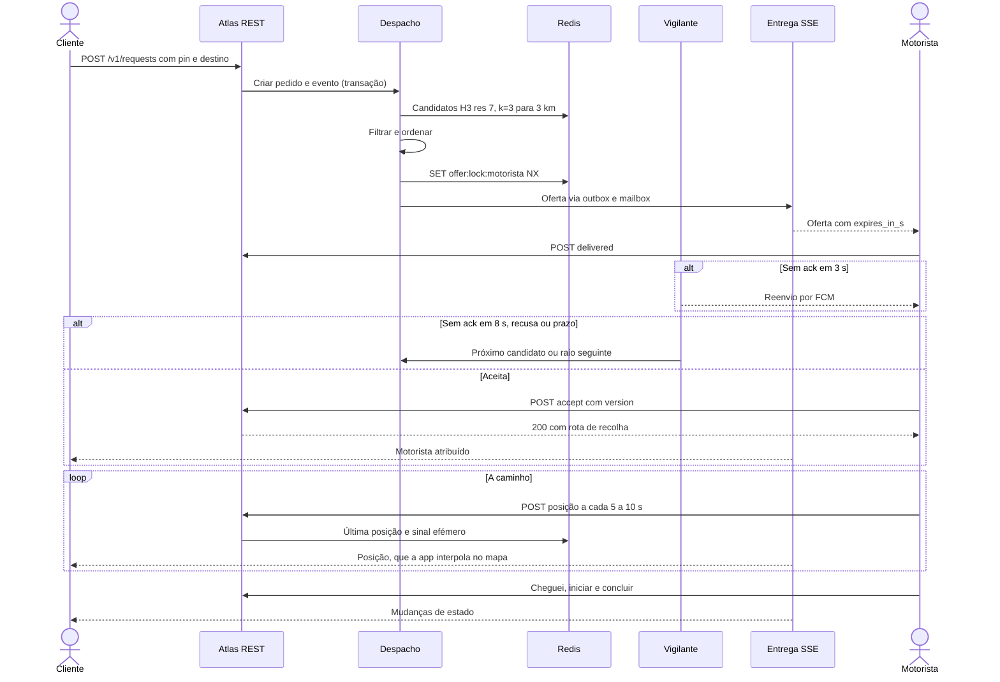

Detalhes:

- **Reserva:** `offer:lock:{provider_id}` com TTL impede duas ofertas ao mesmo
  motorista em simultâneo.
- **Equidade:** dentro de uma faixa de distância, tem prioridade quem está há mais
  tempo sem serviço. Sem ratings, como define o ADR 0010.
- **Tempo total:** o cliente vê sempre "a procurar" e pode cancelar.
- **Navegação:** por ligação para a app de navegação do motorista, sem Navigation
  SDK no MVP.

### 7.3 Reboque

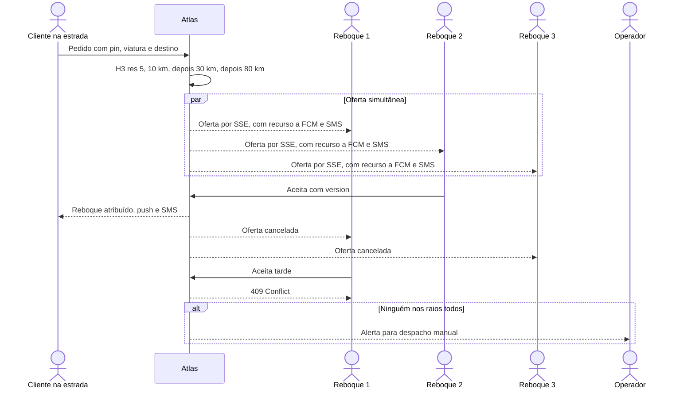

Detalhes:

- **Cliente com pouco sinal:** a app mostra o estado a partir do último evento e
  repete o pedido com a mesma chave. O SMS confirma a atribuição, mesmo sem dados.
- **Compatibilidade:** tipo de viatura e capacidade do reboque ficam em atributos
  do serviço, sem lógica específica no código.
- **Longas distâncias:** o valor do reboque depende do percurso, por isso vale a
  pena pedir uma rota Mapbox no fim da aceitação.

### 7.4 Manutenção

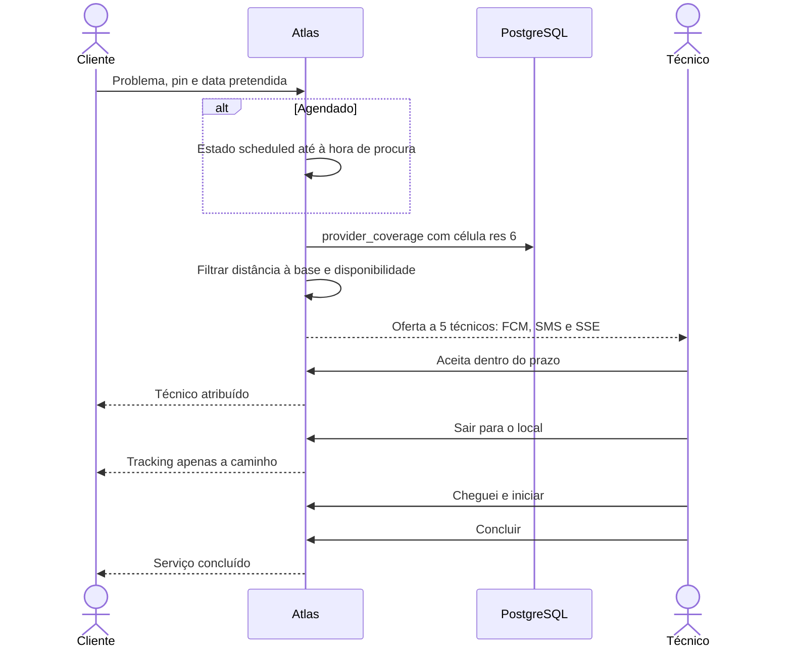

Detalhes:

- `requires_destination = false`, por isso não há rota até um destino final.
- **Cadência de GPS:** só a caminho. Em serviço no local, a posição não é enviada.
- **Prazo em minutos:** o SMS leva uma ligação que abre a app diretamente na
  oferta, para o técnico responder mesmo com a app fechada.

### 7.5 Mudanças

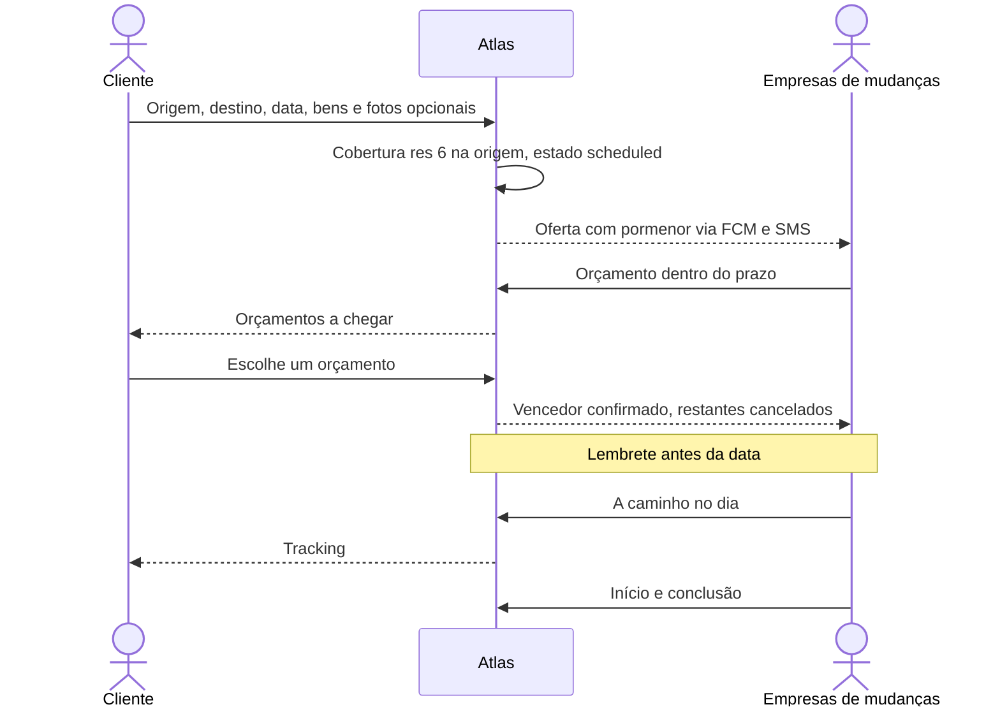

Detalhes:

- **Fotos:** enviadas à parte para o Cloudflare R2, com compressão na app. O evento
  transporta apenas referências, nunca os ficheiros.
- **Distância estimada:** uma chamada de Directions ajuda a orçamentar.
- **Validação ao aceitar:** a transação confirma que o orçamento ainda é válido.

### 7.6 Posição do prestador

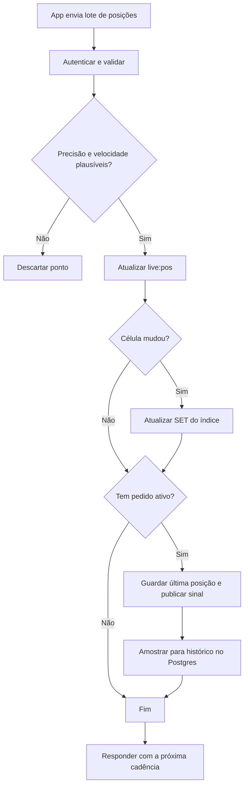

**Cadência decidida pelo servidor:**

| Estado | Enviar a cada | Ou se mover mais de |
|---|---|---|
| Offline | Não envia | |
| Online, sem serviço | 30 s | 150 m |
| Com oferta ou a caminho | 5 a 10 s | 30 m |
| Em viagem com cliente | 10 s | 50 m |
| Em serviço no local | Não envia | |
| Bateria baixa ou rede fraca | Duplicar o intervalo | |

---

## 8. Mapbox

### 8.1 O que usar e quando

| Função | Produto | Quando | Controlo de custo |
|---|---|---|---|
| Mapa nas apps | Maps SDK para Android e iOS | Só em ecrãs com mapa | Iniciar o SDK apenas quando necessário |
| Backoffice | Mapbox GL JS | Operação e hexágonos | Uso interno |
| Escolher o local | Pin + reverse geocoding | Na criação do pedido | Só depois de o pin parar |
| Procurar endereço | Search/Geocoding | Se o utilizador escrever | Debounce; resultados são sugestões |
| Rota após aceitação | Directions | Uma chamada e recálculo raro | Polilinha simplificada |
| ETA de candidatos | Matrix | Fase posterior | Só os melhores candidatos |
| Áreas offline | Tile packs | Cidades de operação | Download em Wi-Fi |
| Navegação | App externa | Motorista | Sem Navigation SDK no MVP |

### 8.2 Limites confirmados na documentação

- **Matrix:** até 25 coordenadas em `driving` e 10 em `driving-traffic`; 60 e 30
  pedidos por minuto, respetivamente. Isto é pouco para cada pesquisa de táxi, e é
  um motivo extra para ordenar pela distância no MVP.
- **Faturação de Matrix:** por elemento (origem × destino), não por pedido.
- **Offline:** o Android limita a 750 tile packs e os termos não permitem
  redistribuir mapas descarregados.
- **Tráfego:** a documentação inclui Angola nos países com ETA baseado em tráfego
  real e típico.

### 8.3 Por confirmar antes de assumir compromissos

1. **Preços.** Só encontrei fontes secundárias, e não totalmente concordantes:
   100 000 pedidos de Directions e 100 000 elementos de Matrix gratuitos por mês, e
   25 000 MAU móveis gratuitos. Confirmar em `mapbox.com/pricing`.
2. **Qualidade dos dados em Angola.** Não encontrei avaliação de estradas ou
   pontos de interesse. Exige um teste de campo em Luanda (incluindo zonas sem
   moradas formais), Benguela, Huambo e Lubango.
3. **Regras de cache de Directions e Matrix.** A documentação remete para as
   restrições de cada API e para os termos de serviço, e não confirmei a regra.
   **Não implementar cache de respostas sem validar os termos.**

### 8.4 Independência do fornecedor

```go
type RoutingProvider interface {
    Route(ctx context.Context, from, to GeoPoint) (Route, error)
    ETAs(ctx context.Context, origins []GeoPoint, to GeoPoint) ([]time.Duration, error)
}
```

- **Falha do Mapbox não pára o despacho:** com timeout curto e circuit breaker, o
  Atlas recorre a distância × fator de estrada, e a app mostra um valor aproximado.
- **Tabela própria de ETA:** tempos reais agregados por par de células res 8 e
  faixa horária. São **dados do Atlas**, vêm das viagens concluídas e não dependem
  das regras de cache do Mapbox. Com o tempo, reduzem as chamadas e refletem melhor
  as estradas locais.
- **Tokens:** token público com restrições nas apps; token secreto só no servidor.

---

## 9. Adaptações a África

### 9.1 Rede e dados

- Eventos abaixo de 2 KB. A Uber viu payloads acima de 1 MB em 3G demorarem 20 a
  50 s e bloquearem heartbeats.
- `Idempotency-Key` em todas as ações que alteram estado, com reenvio automático.
- Posições em lote quando a rede volta.
- Testar HTTP/3 entre app e Cloudflare, uma melhoria de baixo custo para redes
  móveis (a confirmar na configuração da conta).
- Regra de reconexão: backoff de 1 s até 60 s, com jitter.
- Com SSE indisponível, a app consulta o estado por REST a intervalos longos.
- Testar sempre em 3G limitado, com perda de pacotes e passagem Wi-Fi ↔ móvel.

### 9.2 Moradas

Campos do local no pedido:

```text
lat, lng              obrigatórios, a verdade operacional
reference             "Rua da farmácia, portão azul"
contact_phone         opcional; chamada se o prestador não encontrar o local
address_text          sugestão do reverse geocoding, nunca obrigatória
```

### 9.3 Telemóveis modestos

- Prazos relativos, nunca dependentes do relógio do telemóvel.
- SDK de mapas iniciado apenas nos ecrãs que precisam dele.
- Em Manutenção e Mudanças, uma imagem estática pode substituir o mapa completo.
- Ao passar a segundo plano, a app fecha o SSE. O cliente fica coberto por FCM.
- O prestador online usa um serviço em primeiro plano no Android, com notificação
  visível, e deve ser testado em fabricantes com gestão agressiva de bateria.

### 9.4 Expansão para outros países

| Item | Mudança | Situação atual |
|---|---|---|
| Moeda | `currency` por zona ou tarifa | ADR 0008 e o catálogo assumem kwanza |
| Telefone | Validação por país | A confirmar para OTP e login por telefone |
| SMS | Adaptador por país | ADR 0012 já prevê adaptadores |
| Idioma | Modelos pt, fr e en, e outros | ADR 0012 começa em português |
| Política | Por zona | Esta proposta |
| Mapas | Teste de qualidade em cada país | Interface `RoutingProvider` |
| Dados pessoais | Regras de retenção e transferência por país | **Validar juridicamente** |

A localização é um dado pessoal sensível. Antes do lançamento, a lei angolana de
proteção de dados e as regras de cada novo mercado devem ser validadas por um
jurista, incluindo prazos de retenção do histórico.

**Fora de âmbito:** Carteira e pagamentos continuam em pausa, e os estados `paid`
ficam fora, como indica o ADR 0009.

---

## 10. Contratos

### 10.1 Endpoints novos

| Método e caminho | Quem | Função |
|---|---|---|
| `GET /events` | Cliente, Prestador | Stream SSE (ADR 0011) |
| `POST /v1/providers/me/online` e `/offline` | Prestador | Entrar e sair do índice vivo |
| `POST /v1/providers/me/locations` | Prestador | Lote de posições; responde com a cadência |
| `PUT /v1/providers/me/coverage` | Prestador | Base e raio; recalcula células |
| `GET /v1/nearby?lat&lng&category` | Cliente | Agregados por célula |
| `POST /v1/requests` | Cliente | Criar pedido, com `Idempotency-Key` |
| `GET /v1/requests/active` | Ambos | Estado atual, usado no `resync` |
| `POST /v1/offers/{id}/delivered` | Prestador | Ack de entrega |
| `POST /v1/offers/{id}/accept` e `/reject` | Prestador | Decisão |
| `POST /v1/offers/{id}/quote` | Prestador | Orçamento |
| `POST /v1/requests/{id}/select-quote` | Cliente | Escolher orçamento |

### 10.2 Eventos novos

Seguem `<módulo>.<evento>.v<versão>` (ADR 0004). Os eventos de transição do ADR
0009 mantêm-se.

| Evento | Consumidores |
|---|---|
| `requests.offer-created.v1` | Projetor |
| `requests.offer-delivered.v1` | Métricas |
| `requests.offer-expired.v1` | Projetor, métricas |
| `requests.offer-rejected.v1` | Métricas |
| `requests.offer-cancelled.v1` | Projetor, notificações |
| `requests.quote-submitted.v1` | Projetor, notificações |
| `providers.coverage-changed.v1` | Auditoria, métricas |

### 10.3 Chaves Redis

| Chave | Tipo | TTL | Função |
|---|---|---|---|
| `live:pos:{provider}` | Hash | 2,5 × cadência | Posição e estado atuais |
| `live:idx:{cat}:r{res}:{cell}` | Set | Limpeza na leitura | Índice vivo |
| `live:trip:{provider}` | String | Duração do pedido | Liga posição ao pedido ativo |
| `offer:lock:{provider}` | String | Prazo da oferta | Reserva do prestador |
| `rt:box:{user}` | Stream | 200 entradas ou 24 h | Mailbox |
| `rt:pos:{request}` | String | 60 s | Última posição |
| `rt:door` | Pub/Sub | Não se aplica | Sinal entre instâncias |

### 10.4 Tabelas novas

Seguem o esquema `atlas` (ADR 0014) e o RLS onde se aplique (ADR 0015).

```sql
CREATE TABLE service_zones (
    id           UUID PRIMARY KEY DEFAULT gen_random_uuid(),
    country_code CHAR(2) NOT NULL,
    name         TEXT    NOT NULL,
    geom         geography(MultiPolygon, 4326) NOT NULL,
    timezone     TEXT    NOT NULL,
    currency     CHAR(3) NOT NULL,
    is_active    BOOLEAN NOT NULL DEFAULT true
);

CREATE TABLE dispatch_policies (
    id                   UUID PRIMARY KEY DEFAULT gen_random_uuid(),
    category_id          UUID NOT NULL REFERENCES service_categories (id),
    zone_id              UUID REFERENCES service_zones (id), -- NULL = omissão
    candidate_source     TEXT NOT NULL CHECK (candidate_source IN ('live', 'coverage')),
    h3_resolution        SMALLINT NOT NULL,
    radii_km             NUMERIC[] NOT NULL,
    offer_mode           TEXT NOT NULL CHECK (offer_mode IN ('sequential', 'parallel', 'quote')),
    batch_size           SMALLINT NOT NULL,
    offer_ttl_seconds    INTEGER NOT NULL,
    search_ttl_seconds   INTEGER NOT NULL,
    ack_timeout_seconds  INTEGER NOT NULL,
    fallback_channels    TEXT[] NOT NULL,
    updated_at           TIMESTAMPTZ NOT NULL DEFAULT now()
);

CREATE TABLE request_offers (
    id              UUID PRIMARY KEY DEFAULT gen_random_uuid(),
    request_id      UUID NOT NULL,
    provider_id     UUID NOT NULL,
    status          TEXT NOT NULL,
    sent_at         TIMESTAMPTZ NOT NULL DEFAULT now(),
    delivered_at    TIMESTAMPTZ,
    delivered_via   TEXT,
    expires_at      TIMESTAMPTZ NOT NULL,
    responded_at    TIMESTAMPTZ,
    next_action_at  TIMESTAMPTZ,
    quote_cents     BIGINT,
    distance_m      INTEGER,
    UNIQUE (request_id, provider_id)
);
CREATE INDEX request_offers_due_idx ON request_offers (next_action_at)
    WHERE next_action_at IS NOT NULL;
```

Pedidos guardam também o ponto em PostGIS e `pickup_h3_r8`, em `BIGINT`, para
análise. O `h3_resolution` e os raios de cada política são validados no backoffice,
para evitar um `k` que gere pesquisas demasiado grandes.

---

## 11. Falhas e comportamento esperado

| Falha | Comportamento | Recuperação |
|---|---|---|
| Instância reinicia | Ligações SSE caem | App reconecta noutra e faz replay |
| Sinal Pub/Sub perdido | Evento fica na mailbox | Verificação periódica da ligação |
| App lenta | O cursor atrasa-se, sem perder eventos | Lê a mailbox quando conseguir |
| Mailbox excedeu o limite | Id demasiado antigo | `resync` por REST |
| Evento processado 2× | Entrada repetida possível | Dedup por `event_id` e `request_version` |
| Redis indisponível | Matching vivo e mailbox param; o projetor devolve os eventos à fila | Pedidos ficam em `searching`; apps recorrem a REST; alerta crítico |
| RabbitMQ indisponível | Outbox acumula, sem perdas | Relay retoma a publicação |
| Mapbox indisponível | ETA aproximado; mapas em cache | Circuit breaker |
| FCM indisponível | Só SSE e SMS | Passa ao próximo candidato |
| Prestador aceita com atraso | `409 Conflict` | App informa que a oferta terminou |
| Prestador desaparece a meio | Posição expira, sem cancelar automaticamente | Alerta ao cliente e operador |
| Deploy | Fecho gradual | Reconexão distribuída |

**Redis no caminho crítico:** usar persistência AOF e planear alta disponibilidade
antes de produção. A perda total é recuperável, porque o estado real está no
Postgres, as posições regressam em segundos e as apps fazem `resync`.

---

## 12. Impacto nos ADRs

| ADR | Mudança |
|---|---|
| **0008** | Adicionar políticas por categoria e zona; rever a suposição de moeda única; fechar o modelo tarifário por categoria |
| **0009** | Adicionar `scheduled` e `awaiting_choice`, tabela de ofertas, e fechar as questões sobre estratégia e prazos |
| **0010** | Trocar Redis GEO por índice H3; adicionar cobertura; PostGIS mantém-se |
| **0011** | Mailbox antes do envio, sinal em vez de dados, classes, ack e heartbeat adaptável |
| **0012** | Oferta como caso de recurso com prazo curto, sem passar pelo retry normal |
| **Novo** | Build com cgo para H3 e matriz de plataformas |
| **Novo** | Mapbox e `RoutingProvider` |
| **Novo** | Precificação: tarifas, cotações e comissão |

Esta proposta não altera os ADRs. Depois de aprovada, cada decisão passa para o
ADR correspondente.

---

## 13. Fases de implementação

### Fase 0 – Provas, antes de código de produto

- [x] Compilar o Atlas com cgo estático em amd64 e arm64, e decidir se arm64 se mantém.
- [ ] Validar o Mapbox em campo, nas cidades de arranque.
- [ ] Confirmar preços e regras de cache do Mapbox.
- [ ] Medir SSE através de Cloudflare com operadores reais em Angola.
- [ ] Medir preços da concorrência e o ganho líquido dos motoristas em Luanda.
- [ ] Confirmar o regulamento do táxi por aplicação e as regras sobre tarifas.

**Saída:** decisões confirmadas e ADRs atualizados.

### Fase 1 – Localização e despacho (C3)

- [x] `infra/geo/h3index`, com teste de cobertura de `k` nas cidades africanas.
- [x] Zonas, `dispatch_policies` e `provider_coverage`.
- [x] Online/offline, posições e cadência.
- [x] `IProviderLocator`, ofertas e vigilante.
- [x] Máquina de estados do pedido, com bloqueio otimista.
- [x] Tarifas por serviço e zona, cotações e "Aumentar oferta" no Táxi.

**Saída:** Táxi e Manutenção a funcionar por REST e FCM.

### Fase 2 – Entrega em tempo real (C4)

- [x] Projetor, mailbox e sinal; revisão do `infra/sse/hub.go`.
- [x] `GET /events`, replay, `resync` e heartbeat.
- [x] Ack e recurso a FCM e SMS.
- [x] Tracking efémero e fecho gradual em deploy.
- [x] Testes com rede degradada e com falhas injetadas.

**Saída:** Táxi completo e Reboque em oferta simultânea.

### Fase 3 – Mudanças, agenda e operação

- [x] `scheduled`, orçamentos e `awaiting_choice`, conforme o modelo tarifário.
- [ ] Mapa operacional no backoffice, com hexágonos e despacho manual.
- [x] Dashboards da [secção 14](#14-gatilhos-de-evolução).

### Fase 4 – Afinação e expansão

- [x] ETA por Matrix e tabela própria de ETA.
- [x] Equidade e taxa de aceitação na ordenação.
- [ ] Multiplicador por zona com limite máximo, se os dados o justificarem.
- [ ] Primeiro país novo, começando por moeda, SMS e teste de mapas.

### Critérios de aceitação

1. **Sem perda:** evento gerado com o utilizador desligado chega ao reconectar.
2. **Sem perda silenciosa:** subscritor lento recebe todos os eventos por ordem.
3. **Reinício:** matar uma instância durante uma oferta não perde a oferta.
4. **Uma aceitação:** N aceitações em simultâneo resultam num só `200`.
5. **Ack:** sem ack, o FCM é acionado no tempo definido pela política.
6. **Expiração:** uma oferta expirada nunca aparece no replay.
7. **Cobertura:** nenhum prestador dentro do raio fica fora do `k`.
8. **Sem Mapbox:** um pedido de Táxi completa-se com o Mapbox indisponível.
9. **Rede má:** o fluxo completo funciona em 3G limitado com perda de pacotes.
10. **Preço honrado:** o valor cobrado é o da cotação aceite, salvo as alterações
    previstas na [secção 16.3](#163-proposta-para-o-táxi), que ficam registadas.
11. **Cotação expirada:** um pedido com cotação expirada recebe uma nova, sem
    criar pedido nem cobrar um valor que o cliente não viu.

---

## 14. Gatilhos de evolução

### Métricas

| Métrica | Porque importa |
|---|---|
| Tempo do pedido à primeira oferta entregue | Experiência do cliente |
| Tempo até ao ack (p50, p95), por operador | Qualidade real da entrega |
| Percentagem de ofertas por canal | Saúde do SSE |
| Percentagem de ofertas sem resposta | Prestadores falsamente online |
| Reconexões por sessão e razão de `resync` | Estabilidade |
| Taxa de atribuição, por categoria e zona | Saúde do marketplace |
| Bytes por hora de prestador online | Custo real em dados |
| Tempo e número de células por pesquisa | Custo do índice |
| Chamadas ao Mapbox por pedido concluído | Custo |
| Conversão de cotação em pedido | Se o preço é aceite pelo cliente |
| Aceitação de ofertas pelos motoristas e uso de "Aumentar oferta" | Se o preço é aceite pelo motorista |
| Ganho líquido do motorista por hora | Sustentabilidade da oferta |
| Diferença de preço face à Yango, nas rotas de referência | Posição competitiva |
| Diferença entre preço cotado e custo real da viagem | Qualidade da estimativa |

### Quando rever cada decisão

| Evolução | Rever quando |
|---|---|
| gRPC | Os acks HTTP forem um custo relevante, ou houver necessidade real de streaming bidirecional |
| Encaminhamento por utilizador (estilo Helix) | O custo do sinal entre instâncias for relevante |
| Canais SSE separados | Instâncias dedicadas passarem a ser necessárias; o mesmo binário corre só com `/events` |
| Base de dados própria para mailboxes | O Redis deixar de aguentar o volume ou a durabilidade exigida |
| Matrix em todas as pesquisas | O ranking por distância causar atribuições comprovadamente más |
| Multiplicador dinâmico por zona | Houver dados suficientes por célula e falta recorrente de motoristas em picos |

---

## 15. Decisões necessárias

| # | Pergunta | Recomendação |
|---|---|---|
| 1 | Substituir Redis GEO pelo índice H3? | Sim, uma só estrutura para posição viva |
| 2 | Aceitar cgo no build? | Sim, isolado em `infra/geo/h3index` |
| 3 | Manter a imagem arm64? | Só se houver servidores arm64 |
| 4 | Estratégia de oferta por serviço | A da [secção 4](#4-política-de-cada-serviço) |
| 5 | Mudanças com orçamento no MVP 1? | Depende das tarifas; alternativa é o primeiro a aceitar |
| 6 | Reboque, Manutenção e Mudanças podem agendar no MVP 1? | Manutenção e Mudanças sim; Reboque não |
| 7 | Primeiras cidades | Validar Mapbox nelas antes de assumir o custo |
| 8 | Retenção do histórico de posições | Definir com jurídico |
| 9 | Número de instâncias em produção | O desenho serve para uma ou várias |
| 10 | Modelo de preço do Táxi | Preço fixo com "Aumentar oferta", sem negociação |
| 11 | Comissão | 0% por tempo limitado, depois cerca de 10%, a confirmar com o custo real |
| 12 | Como cobrar a comissão em corridas a dinheiro | **Por decidir**; bloqueia o fim do período a 0%, com a Carteira em pausa |
| 13 | Limites legais a preços e comissões | Confirmar antes do lançamento |

---

## 16. Precificação

### 16.1 Como a Uber calcula os preços

A Uber não publica a fórmula exata. O que se segue vem da informação pública, e
parte da imprensa é de 2017–2018, por isso o sistema atual pode ser diferente.

**Corridas:**

| Componente | O que faz |
|---|---|
| Tarifa base | Depende do tempo e da distância previstos |
| Preço dinâmico | Sobe temporariamente quando há mais pedidos do que motoristas |
| Taxa fixa | Cobre custos de operação, regulação e segurança |
| Portagens e sobretaxas | Somam-se quando se aplicam |
| Ajuste por rota e hora | O preço varia consoante o percurso e a hora do dia |
| Alterações na viagem | Paragens, mudança de destino ou espera podem alterar o valor |

- O cliente vê normalmente um preço fixo antes de confirmar.
- Em 2017, a Uber disse usar machine learning para estimar quanto grupos de
  clientes pagariam por um percurso ("route-based pricing"). Afirma usar a procura
  e não a aparente riqueza do cliente.
- O ganho do motorista é calculado à parte, e a Uber fica com a diferença,
  excluindo gorjetas, portagens e certas taxas.
- O preço dinâmico é calculado medindo a oferta e a procura em hexágonos H3.

**Uber Eats:** o total é o preço dos produtos mais taxas de entrega (segundo guias
de terceiros, depende sobretudo da distância), serviço, pedido pequeno, zona
movimentada e entrega prioritária opcional. O único exemplo oficial encontrado é do
Reino Unido, para restaurantes com entrega pela Uber: serviço de 12% (entre £0,99 e
£3,29) e £0,99 adicionais em pedidos abaixo de £10.

### 16.2 Concorrência

Dados recolhidos em 2026-11-01, de fontes entre 2022 e 2026. **Não servem para fixar
tarifas**, só para orientar o posicionamento.

| App | Modelo | Comissão | Lição para o Atlas |
|---|---|---|---|
| **Yango** | Tarifas da app, a partir de 450 Kz segundo o seu site | 13–14% em entrevistas, descontados dos bónus | É a referência de preço a medir |
| **inDrive** | O cliente propõe; o motorista aceita ou contrapropõe | 0% no arranque em Luanda (2025), podendo vir a cobrar; cerca de 10–12% noutros mercados | Dá sensação de controlo, mas é mais lento, e há críticas de que pressiona o ganho do motorista |
| **Uber** | Preço fixo, dinâmico por hexágono | Varia por viagem | Referência técnica; presença em Angola não confirmada |
| **Heetch** | Sem dados para Angola | Sem dados | Por recolher |
| **Kubinga** | Tarifas da app | 25% em 2022 | Dado antigo |

**Posicionamento:** o Atlas não deve tentar ser o mais barato, porque quem tiver mais
capital ganha essa guerra. Deve ser o preço previsível para o cliente e justo para o
motorista.

### 16.3 Proposta para o Táxi

```text
preço = máximo(tarifa mínima, base + km × valor_km + minutos × valor_min)
        + taxas de zona ou aeroporto
```

1. **Preço fixo:** o cliente vê o valor antes de confirmar, válido por poucos
   minutos. Só muda se alterar o destino, acrescentar paragens ou o percurso se
   desviar muito.
2. **"Aumentar oferta" em vez de negociação:** se ninguém aceitar, o cliente pode
   subir 10% ou 20%, e esse aumento vai todo para o motorista. Fica com o melhor do
   inDrive, sem contrapropostas nem atrasos no despacho.
3. **Motorista bem informado:** a oferta mostra o valor líquido, a distância até à
   recolha e o destino. Recolhas longas e esperas acima de alguns minutos são pagas.
4. **Comissão:** 0% por tempo limitado, para competir com o inDrive, e depois cerca
   de 10%, abaixo do que a Yango declarou. O recibo mostra o que o cliente pagou, o
   que o motorista recebeu e o que ficou para o Atlas.
5. **Preço dinâmico:** sem algoritmo no início, só regras públicas para noite e
   aeroporto. O H3 recolhe dados desde o primeiro dia, e mais tarde pode entrar um
   multiplicador por zona com limite máximo.
6. **Sem preços personalizados:** o mesmo percurso à mesma hora custa o mesmo a
   todos, o que protege a confiança.

**Exemplo ilustrativo, não uma recomendação de tarifa:**

| Item | Valor |
|---|---|
| Parâmetros | Base de 300 Kz, 130 Kz/km, 15 Kz/min |
| Viagem de 8 km e 25 min | **1 715 Kz** |
| Comissão de 10% | 172 Kz |
| Motorista recebe | 1 543 Kz |
| Gasolina (10 km com recolha, a 10 km/L e 300 Kz/L) | 300 Kz |

### 16.4 Como definir os valores reais

1. **Medir o mercado:** registar preços da Yango, inDrive e Heetch em cerca de 10
   rotas de Luanda, em três horários, durante duas semanas.
2. **Fixar um mínimo para o motorista:** calcular o ganho líquido por hora depois de
   combustível e manutenção.
3. **Lançar perto da Yango:** ficar a poucos pontos percentuais dela, numa zona de
   teste, e ajustar pela conversão e pela aceitação.
4. **Rever com regularidade:** as tarifas são dados editáveis no backoffice, e devem
   ser revistas quando o combustível ou a inflação mudarem.

### 16.5 Fluxo da cotação

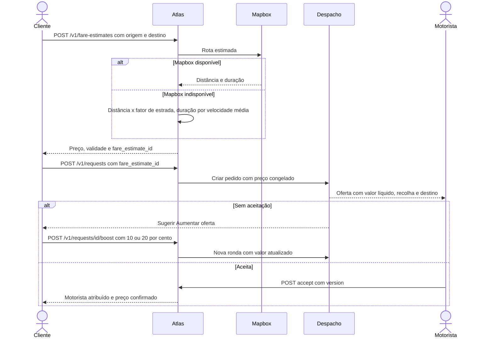

O preço depende dos minutos previstos, por isso a estimativa por estrada é **obrigatória
no cálculo do preço**, mesmo que o despacho funcione sem ela. Quando o valor vem do
recurso sem Mapbox, a cotação fica marcada, para medir o desvio face a viagens reais.

### 16.6 Impacto técnico

Os campos `base_fee_cents`, `per_km_fee_cents` e `per_minute_fee_cents` já existem no
catálogo, mas estão em cêntimos de kwanza e são globais por serviço. Faltam a tarifa
mínima, valores por zona e moeda, e o registo de cada cotação:

```sql
CREATE TABLE service_tariffs (
    id                   UUID PRIMARY KEY DEFAULT gen_random_uuid(),
    service_id           UUID NOT NULL REFERENCES services (id),
    zone_id              UUID REFERENCES service_zones (id), -- NULL = omissão
    currency             CHAR(3) NOT NULL,
    base_fee_cents       BIGINT NOT NULL CHECK (base_fee_cents >= 0),
    per_km_fee_cents     BIGINT NOT NULL CHECK (per_km_fee_cents >= 0),
    per_minute_fee_cents BIGINT NOT NULL CHECK (per_minute_fee_cents >= 0),
    minimum_fee_cents    BIGINT NOT NULL CHECK (minimum_fee_cents >= 0),
    commission_bps       INTEGER NOT NULL CHECK (commission_bps BETWEEN 0 AND 10000),
    valid_from           TIMESTAMPTZ NOT NULL DEFAULT now(),
    valid_until          TIMESTAMPTZ
);

CREATE TABLE fare_estimates (
    id             UUID PRIMARY KEY DEFAULT gen_random_uuid(),
    customer_id    UUID NOT NULL,
    tariff_id      UUID NOT NULL REFERENCES service_tariffs (id),
    distance_m     INTEGER NOT NULL,
    duration_s     INTEGER NOT NULL,
    route_source   TEXT NOT NULL CHECK (route_source IN ('mapbox', 'fallback')),
    total_cents    BIGINT NOT NULL,
    currency       CHAR(3) NOT NULL,
    expires_at     TIMESTAMPTZ NOT NULL,
    created_at     TIMESTAMPTZ NOT NULL DEFAULT now()
);
```

- Tarifas nunca são alteradas: uma mudança cria uma nova versão, para o histórico
  explicar sempre cada preço.
- Valores sempre em inteiros, como o ADR 0008 exige.
- Endpoints novos: `POST /v1/fare-estimates` e `POST /v1/requests/{id}/boost`.
- Evento novo: `requests.fare-boosted.v1`, consumido pelo despacho e pelas métricas.

### 16.7 Outros serviços

Sugestão inicial, a detalhar quando estes serviços forem desenhados:

| Serviço | Modelo sugerido | Porquê |
|---|---|---|
| **Reboque** | Preço fixo, como Táxi, com taxa de saída mais alta | O percurso é conhecido; a deslocação até à viatura pesa no custo |
| **Manutenção** | Taxa de deslocação e orçamento depois do diagnóstico | O trabalho só se conhece no local |
| **Mudanças** | Orçamento do prestador | Depende dos bens a transportar |

### 16.8 Em aberto

- **Cobrança da comissão:** com a Carteira em pausa, o Atlas não tem como reter a
  comissão nas corridas a dinheiro. Os 0% do arranque adiam o problema, mas ele tem de
  estar resolvido antes de começar a cobrar. A Yango, por exemplo, declarou descontá-la
  dos bónus que paga aos motoristas.
- **Regulação:** não foi encontrado o regulamento atual do táxi por aplicação nem as
  regras do INTR sobre tarifas. Pode limitar preços e comissões.
- **Pagamentos:** esta secção define o preço, não como é pago. Carteira e pagamentos
  continuam fora de âmbito.

---

## 17. Fontes

**RAMEN e H3**

- [Uber's Real-Time Push Platform](https://www.uber.com/us/en/blog/real-time-push-platform/)
- [Uber's Next-Gen Push Platform on gRPC](https://www.uber.com/us/en/blog/ubers-next-gen-push-platform-on-grpc/)
- [H3: tabela de resoluções](https://h3geo.org/docs/core-library/restable/)
- [uber/h3-go](https://www.github.com/uber/h3-go)
- [akhenakh/goh3, referido em placekey-go](https://github.com/diegosz/placekey-go)

**Mapbox**

- [Directions: cobertura e tráfego](https://docs.mapbox.com/help/dive-deeper/directions/)
- [Matrix API: limites e faturação](https://docs.mapbox.com/api/navigation/matrix/)
- [Mapas offline no Android](https://docs.mapbox.com/android/maps/guides/offline/concepts/)
- [Caching nas APIs Mapbox](https://docs.mapbox.com/help/dive-deeper/api-caching/)
- Preços, fontes secundárias, a confirmar: [StoreRocket](https://storerocket.io/learn/mapbox-pricing), [Woosmap](https://www.woosmap.com/blog/mapbox-pricing)

**Conectividade em Angola**

As estimativas de cobertura consultadas variam: 4G de cerca de 58% a 77% da
população, consoante a fonte e o ano, com 3G perto de 94% em 2023. Servem de
contexto, não de base para o dimensionamento.

- [DataReportal: Digital 2026 Angola](https://datareportal.com/reports/digital-2026-angola)
- [Internet Society Pulse: Angola](https://pulse.internetsociety.org/en/reports/ao)
- [Expansão: meta de cobertura 4G até 2027](https://expansao.co.ao/angola/interior/angola-quer-atingir-taxa-de-85-de-cobertura-de-internet-4g-ate-2027-114882.html)

**Precificação e concorrência**

- [Uber: estimativa de preço](https://www.uber.com/us/en/price-estimate/)
- [Uber: como funcionam os preços](https://www.uber.com/us/en/marketplace/pricing/)
- [Uber: H3](https://www.uber.com/us/en/blog/h3/)
- [Bloomberg: Uber Starts Charging What It Thinks You're Willing to Pay](https://www.bloomberg.com/news/articles/2017-05-19/uber-s-future-may-rely-on-predicting-how-much-you-re-willing-to-pay)
- [Engadget: resposta da Uber sobre o preço fixo](https://engadget.com/2017/05/19/uber-responds-to-upfront-pricing-worries)
- [Uber UK: taxas e tempo de entrega no Eats](https://www.uber.com/gb/en/blog/understanding-fees-and-arrival-time/)
- [Ridester: guia de taxas do Uber Eats](https://www.ridester.com/?p=623735)
- [Sauce: custos do Uber Eats](https://www.getsauce.com/post/how-much-does-uber-eats-cost)
- [Yango em Luanda](https://yango.com/en_ao/city/luanda/)
- [Valor Económico: bónus e tecnologia na Yango](https://valoreconomico.co.ao/artigo/bonus-e-tecnologia-atraem-motoristas-a-yango)
- [PTI: entrevista sobre a Yango](https://pti.ao/motoristas-e-empresas-de-taxis-estao-a-ganhar-muito-dinheiro-com-a-yango/)
- [APO: inDrive em Luanda](https://www.africa-newsroom.com/press/a-indrive-inova-a-mobilidade-urbana-em-luanda-com-tarifas-negociaveis-e-ausencia-de-comissoes?lang=pt)
- [Ver Angola: inDrive chega a Luanda](https://www.verangola.net/va/en/052025/Transports/44403/inDrive-transport-service-that-allows-you-to-negotiate-fares-with-drivers-arrives-in-Luanda.htm)
- [BusinessDay: negociação como vantagem do inDrive](https://www.businessday.co.za/companies/2026-02-17-indrive-touts-fare-negotiation-as-edge-over-rivals/)
- [The Rideshare Guy: modelo do inDrive](https://therideshareguy.com/are-disruptors-uber-lyft-about-to-be-disrupted-by-indrive/)
- [Expansão: guerra de preços e comissões em Luanda](https://expansao.co.ao/angola/detalhe/guerra-nos-precos-e-nas-comissoes-acentua-se-nos-ubers-da-cidade-luanda-58683.html)
- [Ver Angola: "uberização" em Luanda](https://www.verangola.net/va/en/052022/Transports/30996/‘Uberization’-in-Luanda-increases-price-and-commission-competitiveness.htm)
- [Expat Arrivals: transportes em Angola](https://expatarrivals.com/node/2433)
- [Ver Angola: preços dos combustíveis, junho de 2026](https://www.verangola.net/va/pt/062026/Energia/49106/Governo-aumenta-preço-do-gasóleo-para-420-kwanzas.htm)

**Testes feitos para esta proposta**

`uber/h3-go` v4.5.0 com Go 1.27.3, em 17 cidades africanas. O benchmark foi curto e
serve apenas como ordem de grandeza. O build estático foi feito num binário de
teste, não no Atlas.
